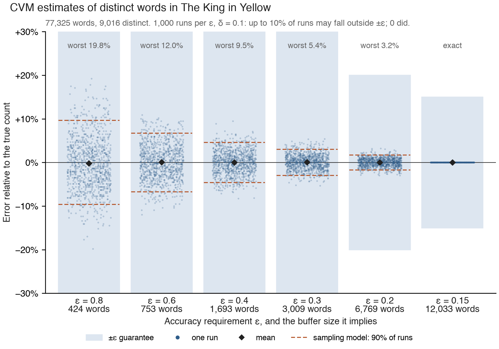

# A Rust implementation of the CVM Algorithm for Counting Distinct Elements

This library implements the algorithm described in

> Chakraborty, S., Vinodchandran, N. V., & Meel, K. S. (2022). *Distinct Elements in Streams: An Algorithm for the (Text) Book*. 6 pages, 727571 bytes. https://doi.org/10.4230/LIPIcs.ESA.2022.34

with the amendment that Don Knuth describes, which makes the estimate unbiased (see [Further Details](#further-details)).

The accompanying article in Quanta is here: https://www.quantamagazine.org/computer-scientists-invent-an-efficient-new-way-to-count-20240516/

## What does that mean
The count-distinct problem, or cardinality-estimation problem refers to counting the number of distinct elements in a data stream with repeated elements. As a concrete example, imagine that you want to count the unique words in a book. If you have enough memory, you can keep track of every unique element you encounter. However, you may not have enough working memory due to resource constraints, or the number of potential elements may be enormous. This constraint is referred to as the bounded-storage constraint in the literature.

In order to overcome this constraint, streaming algorithms have been developed: [Flajolet-Martin](https://en.wikipedia.org/wiki/Flajolet–Martin_algorithm), LogLog, [HyperLogLog](https://en.wikipedia.org/wiki/HyperLogLog). The algorithm implemented by this library is an improvement on these in one particular sense: it is extremely simple. Instead of hashing, it uses a sampling method to compute an [unbiased estimate](https://www.statlect.com/glossary/unbiased-estimator#:~:text=An%20estimator%20of%20a%20given,Examples) of the cardinality (see [Further Details](#further-details)).

# What is an Element
In this implementation, an element is anything implementing the `Ord` trait: various integer flavours, strings, any Struct on which you have implemented the trait. Not `f32` / `f64`, however (unless wrapped in an ordered wrapper type).

## Ownership
The buffer has to keep ownership of its elements. In practice, this is not a problem: relative to its input stream size, the buffer is very small. This is also the point of the algorithm: your data set is very large and your working memory is small; you **don't** want to keep the original data around in order to store references to it! Thus, if you have `&str` elements you will need to create new `String`s to store them. If you're processing text data you'll probably want to strip punctuation and regularise the case, so you'll need new `String`s anyway. If you're processing strings containing numeric values, parsing them to the appropriate integer type (which implements `Copy`) first seems like a reasonable approach.

## Further Details
Don Knuth has written about the algorithm at https://cs.stanford.edu/~knuth/papers/cvm-note.pdf, and does a far better job than I do at explaining it.

In the note's appendix, Knuth shows that the procedure as published in the paper (his **Algorithm X**) gives a biased estimate. When the buffer is still full after one halving, that procedure reports failure, and the estimates from the runs that do not fail are skewed. He also shows that changing "If |B| = s" to "While |B| = s" in its step X6, and never reporting failure, makes the estimate unbiased. This library implements that amended procedure: when the buffer is full, it discards each element with probability ½ and halves _p_, and repeats until the buffer has room.

Knuth's own **Algorithm D** keeps its buffer in a [treap](https://en.wikipedia.org/wiki/Treap#:~:text=7%20External%20links-,Description,(randomly%20chosen)%20numeric%20priority.), a binary tree
> "that’s capable of holding up to _s_ ordered pairs (_a_, _u_), where _a_ is an element of the stream and _u_ is a real number, 0 ≤ _u_ < 1."

and evicts the pair with the largest _u_. This implementation also uses a treap as its buffer, but only as an ordered set of elements: it evicts elements by the coin flips described above. While this results in O(log n) operations instead of O(1) for hash-based approaches, it provides better cache locality for small buffers and eliminates hash collision overhead.

# What does this library provide
Two things: the crate / library, and a command-line utility (`cvmcount`) which will count the unique strings in an input text file.

# Installation
Binaries and installation instructions are available for x64 Linux, Apple Silicon and Intel, and x64 Windows in [releases](https://github.com/urschrei/cvmcount/releases)

You can also build your own if you have Rust installed: `cargo install cvmcount`.

# CLI Example

```shell
cvmcount -t file.txt -e 0.8 -d 0.1 -s 5000
```
`-t --tokens`: a valid path to a text file

`-e --epsilon`: how close you want your estimate to be to the true number of distinct tokens. A smaller ε means you require a more precise estimate. For example, ε = 0.05 means you want your estimate to be within 5 % of the actual value. An epsilon of 0.8 is a good starting point for most applications.

`-d --delta`: the probability that the algorithm's estimate will fall *outside* your desired accuracy range. Your confidence in the estimate is 1 − δ: a delta of 0.001 means you're 99.9 % sure the estimate will be accurate, while a delta of 0.1 (90 % confidence) means there's a higher chance the estimate may be outside your desired range. A delta of 0.1 is a good starting point for most applications, and smaller values cost little memory: see [Choosing epsilon and delta](#choosing-epsilon-and-delta).

Epsilon and delta must both lie strictly between 0 and 1, and the stream size must be at least 1; `cvmcount` exits with an error otherwise.

`-s --streamsize`: this is used to determine buffer size and can be a loose approximation. The closer it is to the stream size, the more accurate the results.

The `--help` option is available.

# Library Usage

The library provides both a simple constructor and a builder pattern for more ergonomic usage:

## Simple Constructor

```rust
use cvmcount::CVM;

let mut cvm = CVM::new(0.05, 0.01, 10_000);
for item in data_stream {
    cvm.process_element(item);
}
let estimate = cvm.calculate_final_result();
```

## Builder Pattern (Recommended)

The builder pattern provides better readability and validation:

```rust
use cvmcount::CVM;

// Using defaults (epsilon=0.8, confidence=0.9, size=1000)
let mut cvm: CVM<String> = CVM::builder().build().unwrap();

// Custom configuration with confidence level
let mut cvm: CVM<i32> = CVM::builder()
    .epsilon(0.05)        // 5 % accuracy
    .confidence(0.99)     // 99 % confidence
    .estimated_size(50_000)
    .build()
    .unwrap();

// Using delta (failure probability) instead of confidence
let mut cvm: CVM<String> = CVM::builder()
    .epsilon(0.1)         // 10 % accuracy
    .delta(0.01)          // 1 % chance of failure
    .estimated_size(1_000)
    .build()
    .unwrap();

// Process your data
for word in text.split_whitespace() {
    cvm.process_element(word.to_string());
}

let estimate = cvm.calculate_final_result();
println!("Estimated unique words: {}", estimate as usize);
```

The builder validates parameters and provides clear error messages for invalid inputs.

## Streaming Interface

For processing iterators directly, you can use the streaming methods:

```rust
use cvmcount::{CVM, EstimateDistinct};

// Process an entire iterator with CVM instance
let mut cvm: CVM<i32> = CVM::builder().epsilon(0.05).build().unwrap();
let numbers = vec![1, 2, 3, 2, 1, 4, 5];
let estimate = cvm.process_stream(numbers);

// Or use the iterator extension trait for one-liners
let estimate = (1..=1000)
    .cycle()
    .take(10_000)
    .estimate_distinct_count(0.1, 0.1, 10_000);

// With builder pattern
let words = vec!["hello".to_string(), "world".to_string(), "hello".to_string()];
let builder = CVM::<String>::builder().epsilon(0.05).confidence(0.99);
let estimate = words.into_iter().estimate_distinct_with_builder(builder).unwrap();

// When working with borrowed data, map to owned explicitly
let borrowed_words = vec!["hello", "world", "hello"];
let estimate = borrowed_words
    .iter()
    .map(|s| s.to_string())
    .estimate_distinct_count(0.1, 0.1, 1000);
```

The streaming interface accepts owned values to avoid cloning within the algorithm, making the ownership requirements explicit.

## Choosing epsilon and delta
The two parameters control different things:

- ε sets the accuracy: the estimate should be within a factor of 1 ± ε of the true count.
- δ sets the reliability: the probability that the estimate falls outside that range (a _miss_) is at most δ. The builder's `confidence` is 1 − δ.

Together with the stream size _m_, they set the buffer size, which is the maximum number of elements that the counter stores: ⌈(12 / ε²) · log₂(8*m* / δ)⌉. The two parameters affect the buffer size very differently. Halving ε makes the buffer four times larger:

| ε (with δ = 0.01, _m_ = 10⁶) | 0.2 | 0.1 | 0.05 |
|---|---|---|---|
| buffer | 8,873 | 35,491 | 141,963 |

In the formula, δ appears only inside the logarithm, so a much smaller δ costs little memory:

| buffer, ε = 0.1 | δ = 0.1 | δ = 0.01 | δ = 0.001 | δ = 10⁻⁶ |
|---|---|---|---|---|
| _m_ = 10⁶ | 31,505 | 35,491 (+13%) | 39,477 (+25%) | 51,436 (+63%) |
| _m_ = 10⁹ | 43,464 | 47,450 (+9%) | 51,436 (+18%) | 63,395 (+46%) |

Choose ε first, from the accuracy that you need and the memory that you have. Then choose a small δ.

To choose δ, decide how many estimates you will make, and what chance of a miss you can accept:

- For a single estimate, δ = 0.01 gives at most a 1% chance of a miss.
- If you make many estimates, for example one each day or one for each shard of a data set, the probability that at least one of _k_ estimates misses is at most _k_ · δ. To keep that probability below α, set δ = α / _k_. For example, for 365 daily counts with at most a 1% chance that any of them misses, set δ = 0.01 / 365 ≈ 2.7 × 10⁻⁵. At ε = 0.1 and _m_ = 10⁶, the buffer is then 45,705 elements: 29% more than at δ = 0.01.

The stream size affects the buffer in the same way as δ: if the stream turns out to be ten times longer than the size you gave, the paper's bound on the chance of a miss rises at most tenfold, the same as choosing a δ ten times larger. A rough figure for the stream size is fine. If you are unsure, err on the high side, because a larger figure costs little memory.

The guarantee holds for every possible stream, so for a typical stream, misses are much less frequent than δ permits. In the analysis below, none of 6,000 estimates fell outside ±ε at δ = 0.1. Use δ to state what you can rely on, not what you expect to see.

## Analysis



Each column shows 1,000 estimates of the number of distinct words in [The King in Yellow](benches/kiy.txt) (77,325 words, 9,016 distinct), with δ = 0.1 and the stream size set to the word count. The shaded band is the range that the ε guarantee permits. δ = 0.1 permits 10% of estimates to fall outside it; none did. At ε = 0.15 the buffer can hold every distinct word, so every estimate is exact.

The diamond marks the mean estimate. Because the estimator is unbiased, the mean should be the true count: at every ε, the 95% confidence interval of the mean (in the table below) contains zero error.

The dashed lines mark the range that should hold 90% of the estimates if each distinct word is in the buffer independently with the final sampling probability _p_. This is the sampling model that the paper's analysis uses at a fixed _p_ (Claim 5 in the [revised paper](https://arxiv.org/abs/2301.10191v2)), and every run here ended at the same _p_. The model matches the observed spread closely. It also shows why the errors are much smaller than ε: the error depends on the number of words in the buffer, and the buffer size formula is chosen so that the guarantee holds for every possible stream, which leaves a large margin for a typical one.

| ε | buffer | final p | mean (95% CI) | 5th–95th percentile | model 90% range | worst |
|---|---|---|---|---|---|---|
| 0.8 | 424 | 1/32 | −0.22% (±0.38%) | −9.5% to +10.7% | ±9.6% | 19.8% |
| 0.6 | 753 | 1/16 | +0.07% (±0.25%) | −6.7% to +6.8% | ±6.7% | 12.0% |
| 0.4 | 1,693 | 1/8 | −0.01% (±0.17%) | −4.7% to +4.5% | ±4.6% | 9.5% |
| 0.3 | 3,009 | 1/4 | +0.09% (±0.11%) | −2.8% to +3.0% | ±3.0% | 5.4% |
| 0.2 | 6,769 | 1/2 | +0.03% (±0.06%) | −1.6% to +1.6% | ±1.7% | 3.2% |
| 0.15 | 12,033 | 1/1 | +0.00% (±0.00%) | +0.0% to +0.0% | ±0.0% | 0.0% |

To reproduce the figure and the table:

```shell
cargo run --release --example accuracy > accuracy.csv
uv run analysis/plot_accuracy.py accuracy.csv cvmcount.png
```

## Note
If you're thinking about using this library, you presumably know that it only provides an estimate (within the specified bounds), similar to something like HyperLogLog. You are trading accuracy for speed and memory usage!

## Perf
Calculating the unique tokens in a [418K UTF-8 text file](https://www.gutenberg.org/ebooks/8492) using the CLI takes 7.2 ms ± 0.3 ms on an M2 Pro. Counting 10e6 7-digit integers takes around 13.5 ms. An exact count using the same regex and HashSet runs in around 18 ms. Run `cargo bench` for more.

## Implementation Details
The CLI app strips punctuation from input tokens using a regex. I assume there is a small performance penalty, but it seems like a small price to pay for increased practicality.


